<div align="center">

  <!-- ANIMATED VECTOR BANNER -->
  

  <br/><br/>

  <!-- BADGES ROW -->
  <a href="https://dhruv-lx.github.io/ODDVEIL/"></a>
  <a href="#-quickstart"></a>
  
  

  <br/><br/>

  <h3>🔮 A Psychological Game of Wits, Probability, and Deception</h3>

  <p align="center">
    <b>Dual Platform Architecture</b>: Modern Glassmorphic Web App &bull; Pure Java 21 Swing Vector GUI &bull; Procedural Sound Synthesizer &bull; Zero External Dependencies
  </p>

  <p align="center">
    <a href="#-game-overview">Overview</a> &bull;
    <a href="#-evolution-11th-grade-vs-modern">The Evolution</a> &bull;
    <a href="#-game-mechanics">Mechanics</a> &bull;
    <a href="#-architecture--ai-design">AI &amp; Architecture</a> &bull;
    <a href="#-quickstart">Quickstart</a> &bull;
    <a href="#-project-structure">Structure</a>
  </p>

</div>

---

## 📖 Game Overview

**The Marble** is an enhanced, turn-based psychological wagering game inspired by the Korean *Gganbu* duel (Squid Game). 

Two players enter the arena with **10 marbles each**. The objective: claim all 20 marbles through shrewd betting, mind games, and reading your opponent. You face **Leo**, an adaptive AI rival equipped with emotional reaction models, varying risk appetites, and dynamic dialogue states.

> **Origin Story**: This project originated in the 11th grade as a simple command-line script in `Marbel.java`. It has been completely re-architected into an industry-grade, dual-platform software portfolio piece featuring custom vector rendering, procedural sound synthesis, and clean object-oriented architecture.

---

## 🚀 Evolution: 11th Grade vs Modern

| Feature | 🎒 11th Grade Prototype (`Marbel.java`) | ⚡ Modern Architecture (`The Marble`) |
| :--- | :--- | :--- |
| **Interface** | Plain console text scanner (`System.out.println`) | **Dual UI**: Glassmorphic Web App + Java Swing 2D Vector GUI |
| **Audio** | No audio | **Procedural Audio Synthesizer** (Web Audio API & Java Audio) |
| **Turns** | One-sided guessing only (Player bets, Leo hides) | **Alternating Attack & Defense** (You hide, Leo bets & guesses!) |
| **AI Opponent** | Static uniform random numbers (`random.nextInt()`) | **Adaptive AI Model** with 3 tiers (Casual, Strategic, Mind Reader) |
| **AI Personality** | Static printed strings | **Dynamic Emotional States** (Confident, Smug, Panicking, Victorious) |
| **Visuals** | Raw console numbers | **Real-time 3D Glass Marbles** with radial gradients & highlights |
| **Telemetry** | None | **Live Battle Stream, Streak Multipliers & Accolade Badges** |
| **Dependencies** | Standard Java | **Zero Third-Party Libraries** (Runs anywhere out of the box) |

---

## 🎮 Game Mechanics

```mermaid
stateDiagram-v2
    [*] --> PlayerRegistration
    PlayerRegistration --> RoundStart : 10 Marbles Each

    state "Round Progression" as TurnLoop {
        state "Odd Round: Player Attacks" as AttackPhase {
            LeoHides : Leo secretly conceals X marbles
            PlayerBets : Player selects wager (1 to Max)
            PlayerGuesses : Player calls ODD or EVEN
            LeoHides --> PlayerBets --> PlayerGuesses
        }
        state "Even Round: Leo Attacks" as DefensePhase {
            PlayerHides : Player conceals X marbles in fist
            LeoBets : Leo evaluates risk & wagers
            LeoGuesses : Leo predicts ODD or EVEN
            PlayerHides --> LeoBets --> LeoGuesses
        }
    }

    RoundStart --> AttackPhase : Round 1, 3, 5...
    RoundStart --> DefensePhase : Round 2, 4, 6...

    AttackPhase --> ResultEvaluation
    DefensePhase --> ResultEvaluation

    state "Result Evaluation" as ResultEvaluation {
        CheckWin : Guess Matches Hidden Count parity?
        TransferMarbles : Winner gains bet amount from loser
        UpdateEmotion : Leo's expression & dialogue shift
        CheckWin --> TransferMarbles --> UpdateEmotion
    }

    ResultEvaluation --> RoundStart : Both players have > 0 marbles
    ResultEvaluation --> Victory : Leo Marbles == 0
    ResultEvaluation --> Defeat : Player Marbles == 0

    Victory --> [*] : Gganbu King Accolade
    Defeat --> [*] : Game Over
```

### Turn Rules:
1. **Attack Phase (Odd Rounds)**:
   * Leo conceals a secret count of marbles in his closed fist.
   * You choose your wager (1 to minimum of either player's bag) and guess **ODD** or **EVEN**.
   * If correct: You win your wager from Leo. If incorrect: Leo takes your wager.
2. **Defense Phase (Even Rounds)**:
   * The tables turn! You choose how many marbles to conceal in your closed fist.
   * Leo calculates his wager and guesses your parity.
   * If Leo is wrong: You seize Leo's wager!

---

## 🧠 Architecture & AI Design

### 1. Procedural Audio Engine (Zero External Audio Files)
Rather than bundling bulky `.mp3` or `.wav` files, **The Marble** synthesizes its crystalline glass clinks, victory fanfares, and defeat tones mathematically:
* **Web Audio API**: Dynamically generates an `OscillatorNode` with exponential frequency ramps ($2200\text{ Hz} \to 1400\text{ Hz}$) connected to an envelope-decaying `GainNode` to simulate the acoustic resonance of glass spheres colliding.
* **Java Sampled Audio**: Synthesizes pure PCM byte waveforms directly into `javax.sound.sampled.SourceDataLine` at 44.1 kHz.

### 2. Adaptive AI Model ("Leo")
Leo's intelligence scales across three configurable tiers:
* **Casual Leo (Easy)**: Uniform random guesses ($\sim 35\%$ accuracy) with conservative bets.
* **Strategic Leo (Normal)**: Probabilistic betting proportional to bankroll, moderate pattern matching ($\sim 65\%$ prediction rate).
* **Mind Reader (Hard)**: Aggressive high-stakes betting with psychological profiling and bluff compensation ($\sim 85\%$ accuracy).

### 3. Vector-Rendered 2D Graphics Engine
* Custom `RadialGradientPaint` shaders render 3D glass marbles with ambient occlusion, drop shadows, and specular reflection highlights.
* Standalone `CustomButton` and `CustomSlider` classes avoid native OS look-and-feel conflicts (preventing Windows Swing blank button glitches).

---

## 📂 Project Structure

```
the-marble/
├── .github/
│   └── workflows/
│       └── deploy.yml            # Automated CI/CD GitHub Pages deployment
├── assets/
│   ├── css/
│   │   └── style.css             # Glassmorphic cyberpunk styling & animations
│   ├── js/
│   │   └── game.js               # Web game engine & procedural audio synthesizer
│   └── images/
│       └── banner.svg            # Animated vector GitHub banner
├── src/
│   ├── TheMarbleGUI.java         # Modern Java 21 Swing GUI application
│   └── legacy/
│       └── OriginalConsole11th.java # Original 11th-grade console code
├── .gitignore                    # Production git hygiene (bytecode, caches)
├── index.html                    # Zero-dependency browser entry point
├── LICENSE                       # MIT License
├── README.md                     # Portfolio documentation
└── run.bat                       # One-click Windows desktop launcher
```

---

## ⚡ Quickstart

### 🌐 Option 1: Play in Browser (Instant)
Simply open [`index.html`](index.html) in any modern browser (Chrome, Edge, Firefox, Safari).
```bash
# Or start a quick local server
npx serve .
# Or Python
python -m http.server 8000
```
> **GitHub Pages Ready**: Push this repository to GitHub, enable Pages in repository settings, and your game is live globally!

---

### ☕ Option 2: Run Java Desktop GUI

Ensure you have **Java JDK 11+** installed:

#### Windows (One-Click):
Double-click `run.bat` or run in terminal:
```cmd
.\run.bat
```

#### Manual Terminal Commands:
```bash
# 1. Compile to bin directory
javac -d bin src/TheMarbleGUI.java

# 2. Run the application
java -cp bin TheMarbleGUI
```

---

### 📜 Option 3: Original 11th Grade Heritage Console

To experience the original terminal script written during school days:
```bash
javac -d bin src/legacy/OriginalConsole11th.java
java -cp bin Marbel
```

---

## 🏆 Accolades & Trophies

Unlock special badges as you outsmart Leo:
* 🎯 **First Blood**: Win your first round.
* 🔥 **On Fire (3x)**: Achieve a 3-round victory streak.
* 💎 **High Roller**: Wager and win $\ge 5$ marbles in a single call.
* 👑 **Gganbu King**: Claim all 20 marbles and eliminate Leo.

---

## 🛡️ License

Distributed under the **MIT License**. See [`LICENSE`](LICENSE) for details.

---

<div align="center">
  <sub>Engineered with passion by <b>Dhruv</b> &bull; From an 11th-grade classroom idea to a full-stack portfolio showcase.</sub>
</div>
